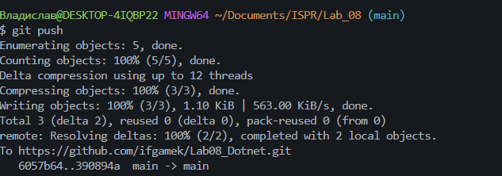
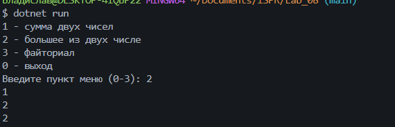

### Практическая работа № 8

### ИСП-243

### доделано 28.10

### Что изучено

- использование в качестве функции int, long и другие

- Использование многих функций в одной в C#

- Структура Функций C#

